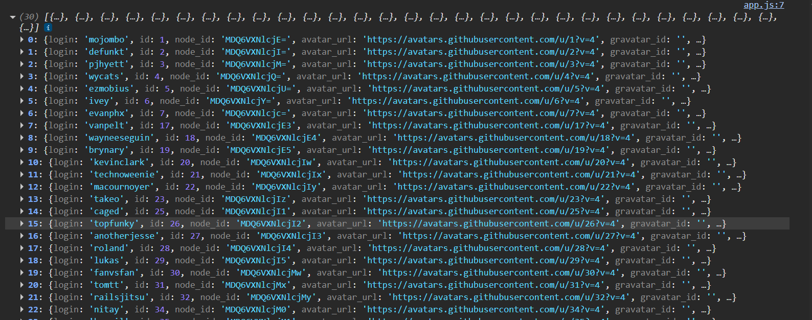
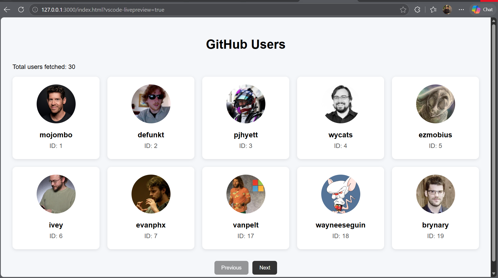
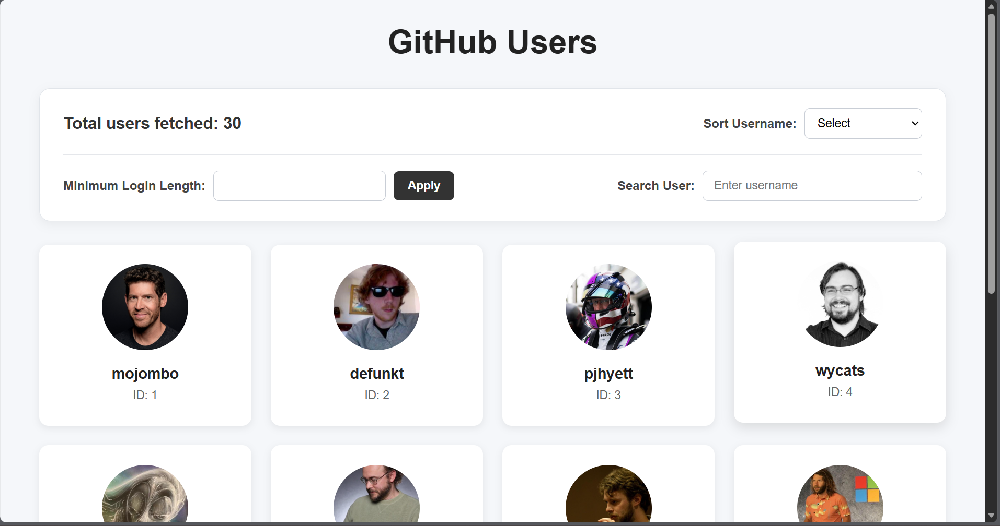
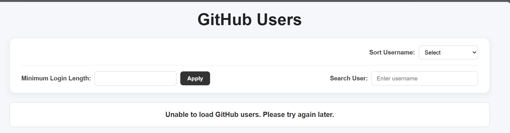
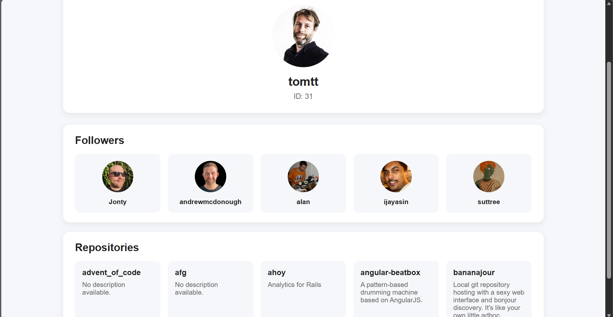

## Assignment: Async JavaScript & GitHub Users API

Build a GitHub Users application using HTML, CSS, and vanilla JavaScript. API: https://api.github.com/users


### 1. Fetch & Display Users

· Fetch users from the GitHub Users API automatically when the page loads.

· Display the total number of users fetched.

· Display users in a clean list, table, or card layout.

· Add pagination for the fetched users.

· Show a loading skeleton while users are being fetched.

#### 1. Create Project and index.html, style.css and app.js files
#### 2. Add Intial structure of index.html
#### 3. Create function to fetch user and view them in console
``` js
async function fetchUsers(){

    const response = await fetch('https://api.github.com/users');

    if(!response.ok){

        throw new Error("Failed to fetch Github users");

    }

    const users = await response.json();

    console.log(users);

}

fetchUsers();

```


#### 4. Display the total number of users fetched.

``` js

function displayUsers(users) {

    const container =
        document.getElementById("user-container");

    users.forEach((user) => {

        const userElement =
            document.createElement("div");

        userElement.className = "user-card";

        userElement.innerHTML = `
            
            <h3>${user.login}</h3>
            <p>ID: ${user.id}</p>
        `;

        container.appendChild(userElement);
    });
}

fetchUsers();

```

#### 5. Add Pagination function

``` js

function setupPagination() {
  const prevButton = document.getElementById("prev-btn");
  const nextButton = document.getElementById("next-btn");

  prevButton.addEventListener("click", () => {
    if (currentPage > 1) {
      currentPage--;
      displayUsers(currentUsers);
      updateButtons();
    }
  });

  nextButton.addEventListener("click", () => {
    const totalPages = Math.ceil(currentUsers.length / usersPerPage);

    if (currentPage < totalPages) {
      currentPage++;
      displayUsers(currentUsers);
      updateButtons();
    }
  });

  updateButtons();
}

```
#### 6. Output



### 2. Filtering, Search & Sorting

For each user, display only:

· Login

· ID

· Avatar

Add the following features:

· Filter users by minimum login length.

· Add an Apply button for the login-length filter.

· Add search by user name/login.

· Add sorting by username:

· A → Z

· Z → A

· Search, filtering, and sorting should work with the already-fetched users.

· Display the number of users remaining after filtering/search.

· An empty search should show all users.

· Reset pagination to the first page whenever a filter, search, or sort is applied.

#### 1. Filter by minimum login length

```html

<div id="filter-section">
            <label for="login-length">Minimum Login Length:</label>
            <input type="number" id="login-length" min="1">
            <button id="apply-filter">Apply</button>
        </div>

```


#### 2. Search by username

``` html
<div id="search-section">
            <label for="search-user">Search User:</label>
            <input
                type="text"
                id="search-user"
                placeholder="Enter username"
            >
        </div>

```
#### 3. Sorting

```html

<div id="sort-section">
            <label for="sort-users">Sort Username:</label>
            <select id="sort-users">
                <option value="">Select</option>
                <option value="asc">A → Z</option>
                <option value="desc">Z → A</option>
            </select>
        </div>

```

#### 4. JS function

``` js

function applyFilters() {
  currentUsers = allUsers.filter((user) => {
    const matchesLength = user.login.length >= minimumLoginLength;

    const matchesSearch = user.login
      .toLowerCase()
      .includes(searchText);

    return matchesLength && matchesSearch;
  });

  if (sortValue === "asc") {
    currentUsers.sort((a, b) =>
      a.login.toLowerCase().localeCompare(b.login.toLowerCase())
    );
  }

  if (sortValue === "desc") {
    currentUsers.sort((a, b) =>
      b.login.toLowerCase().localeCompare(a.login.toLowerCase())
    );
  }

  currentPage = 1;

  const userCount = document.getElementById("user-count");
  userCount.textContent = `Users found: ${currentUsers.length}`;

  displayUsers(currentUsers);
  updateButtons();
}

function applyLoginLengthFilter() {
  const input = document.getElementById("login-length");

  minimumLoginLength = Number(input.value) || 0;

  applyFilters();
}

```

#### 5. Event Listeners

``` js
document
  .getElementById("apply-filter")
  .addEventListener("click", applyLoginLengthFilter);

document
  .getElementById("search-user")
  .addEventListener("input", searchUsers);

document
  .getElementById("sort-users")
  .addEventListener("change", sortUsers);
  
```

#### 6. Output




### 3. Async/Await & Error Handling

· Handle API requests using asynchronous JavaScript.

· Handle unsuccessful responses and request failures gracefully.

· Display a friendly error message if users cannot be loaded.

· The application should not remain blank or fail silently when an error occurs.


#### 1. Update Index.html

``` html

<div id="error-message"></div>

```

#### 2. Update Style.css

``` css
#error-message {
    display: none;
    text-align: center;
    padding: 20px;
    margin: 20px 0;
    border-radius: 10px;
    background-color: #fff;
    border: 1px solid #ccc;
    color: #333;
    font-size: 17px;
    font-weight: 600;
}
```

#### 3. Update Fetch users function

``` js

async function fetchUsers() {

    const skeleton = document.getElementById("loading-skeleton");
    const errorMessage = document.getElementById("error-message");
    const userContainer = document.getElementById("user-container");
    const pagination = document.getElementById("pagination");

    try {

        skeleton.style.display = "grid";
        errorMessage.style.display = "none";

        const response = await fetch(
            "https://api.github.com/usersa"
        );

        if (!response.ok) {
            throw new Error("Failed to fetch GitHub users");
        }

        const users = await response.json();

        allUsers = users;
        currentUsers = users;

        const userCount = document.getElementById("user-count");

        userCount.textContent =
            `Total users fetched: ${users.length}`;

        console.log(users);

        displayUsers(currentUsers);
        setupPagination();

    }
    catch (error) {

        console.error("Error loading users:", error);

        errorMessage.textContent =
            "Unable to load GitHub users. Please try again later.";

        errorMessage.style.display = "block";

        userContainer.innerHTML = "";

        pagination.style.display = "none";
    }
    finally {

        skeleton.style.display = "none";
    }
}

```

 #### Output




### 4. User Details

· Allow a user to open a details page by selecting a user.

· Display the selected user's basic information.

· Display the user's first 5 followers.

· Display the user's first 5 repositories.

· Fetch followers and repositories concurrently.

· Show a loading skeleton while the details data is being fetched.

· Handle errors with a friendly message.

· Provide a way to return to the users list.


#### 1. Create user-detail.html, user-detail.css, user-detail.js

#### 2. Fetch user detail

``` js
const params = new URLSearchParams(window.location.search);

const username = params.get("username");

console.log("Selected username:", username);

async function fetchUserDetails() {
  const loading = document.getElementById("details-loading");

  const errorMessage = document.getElementById("details-error");

  const userDetails = document.getElementById("user-details");

  try {
    loading.style.display = "block";
    errorMessage.style.display = "none";
    userDetails.style.display = "none";

    const userResponse = await fetch(
      `https://api.github.com/users/${username}`,
    );

    if (!userResponse.ok) {
      if (userResponse.status === 403 || userResponse.status === 429) {
        throw new Error(
          "GitHub API rate limit reached. Please try again later.",
        );
      }

      if (userResponse.status === 404) {
        throw new Error("User could not be found.");
      }

      throw new Error("Failed to load user details.");
    }

    const user = await userResponse.json();

    document.getElementById("user-avatar").src = user.avatar_url;

    document.getElementById("user-avatar").alt = user.login;

    document.getElementById("user-login").textContent = user.login;

    document.getElementById("user-id").textContent = user.id;

    const [followersResponse, repositoriesResponse] = await Promise.all([
      fetch(`https://api.github.com/users/${username}/followers`),

      fetch(`https://api.github.com/users/${username}/repos`),
    ]);

    if (!followersResponse.ok || !repositoriesResponse.ok) {
      if (
        followersResponse.status === 403 ||
        followersResponse.status === 429 ||
        repositoriesResponse.status === 403 ||
        repositoriesResponse.status === 429
      ) {
        throw new Error(
          "GitHub API rate limit reached. Please try again later.",
        );
      }

      throw new Error("Failed to load followers or repositories.");
    }

    const [followers, repositories] = await Promise.all([
      followersResponse.json(),

      repositoriesResponse.json(),
    ]);

    displayFollowers(followers);

    displayRepositories(repositories);

    userDetails.style.display = "block";
  } catch (error) {
    console.error("Error loading user details:", error);

    errorMessage.textContent = error.message;

    errorMessage.style.display = "block";
  } finally {
    loading.style.display = "none";
  }
}

```

#### 3. Display Followers

``` js

function displayFollowers(followers) {
  const container = document.getElementById("followers-container");

  container.innerHTML = "";

  followers.slice(0, 5).forEach((follower) => {
    const followerElement = document.createElement("div");

    followerElement.className = "follower-card";

    followerElement.innerHTML = `
            

            <p>${follower.login}</p>
        `;

    container.appendChild(followerElement);
  });
}

```

#### 4. Display Repositories

``` js

function displayRepositories(repositories) {
  const container = document.getElementById("repositories-container");

  container.innerHTML = "";

  repositories.slice(0, 5).forEach((repository) => {
    const repositoryElement = document.createElement("div");

    repositoryElement.className = "repository-card";

    repositoryElement.innerHTML = `
            <h3>${repository.name}</h3>

            <p>
                ${repository.description || "No description available."}
            </p>
        `;

    container.appendChild(repositoryElement);
  });
}

```

#### 5. Output




## GitHub Users API Application

A simple GitHub Users application built using HTML, CSS, and Vanilla JavaScript. The application fetches GitHub users and provides pagination, search, filtering, sorting, and user details.

### Setup and Run

1. Clone the repository.
2. Open the project in VS Code.
3. Open `index.html` using a browser or Live Server.
4. The application automatically fetches users from the GitHub API.

No additional dependencies or installation are required.

### Features

- Fetches and displays GitHub users.
- Displays user login, ID, and avatar.
- Pagination with Previous, Next, and page number buttons.
- Filter users by minimum login length.
- Search users by username/login.
- Sort users alphabetically in A-Z or Z-A order.
- Displays the remaining user count after filtering/searching.
- User details page with basic user information.
- Displays the first 5 followers and repositories.
- Fetches followers and repositories concurrently using `Promise.all()`.
- Loading skeletons while API requests are in progress.
- Handles API errors and GitHub rate-limit errors with user-friendly messages.

### API Endpoints

#### Get Users

```text
https://api.github.com/users
```

Fetches the list of GitHub users.

#### Get User Details

```text
https://api.github.com/users/{username}
```

Fetches details of the selected user.

#### Get Followers

```text
https://api.github.com/users/{username}/followers
```

Fetches followers of the selected user.

#### Get Repositories

```text
https://api.github.com/users/{username}/repos
```

Fetches repositories of the selected user.

### Application Flow

1. The application loads and fetches GitHub users.
2. Users are displayed in cards with pagination.
3. Users can be searched, filtered by login length, and sorted by username.
4. Selecting a user opens the User Details page.
5. The selected user's basic details are fetched and displayed.
6. Followers and repositories are fetched concurrently using `Promise.all()`.
7. The first 5 followers and repositories are displayed.
8. Loading skeletons and error messages are shown during loading or when an API request fails.


